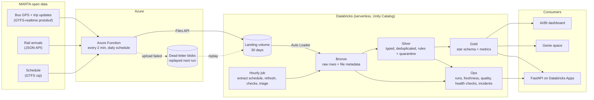
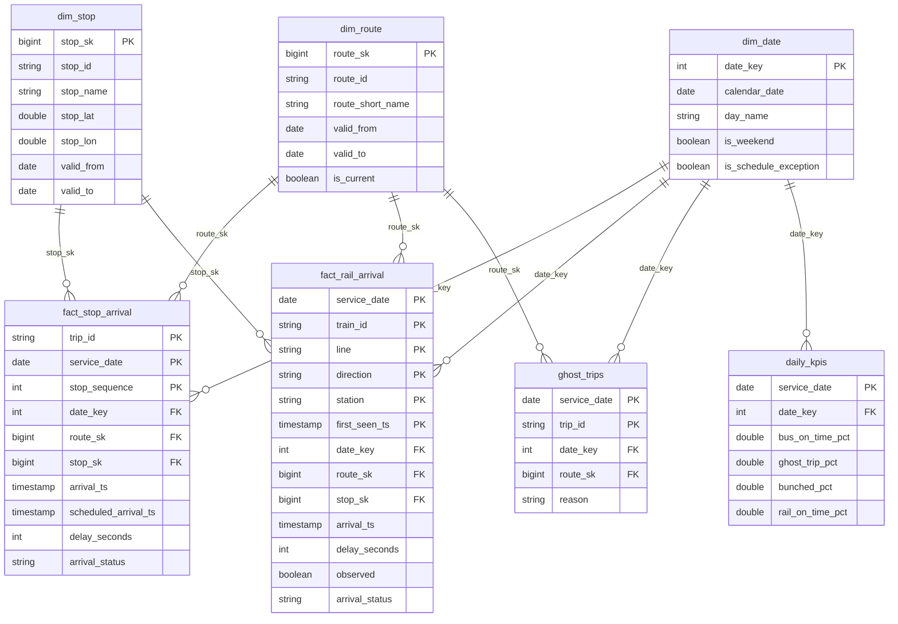

# TransitPulse ATL: design

How the system is put together and why. Detailed requirements are in `specs/`, decisions in `adr/`, and operating steps in `runbooks/`.

## Architecture

| Hop | Safety net |
|---|---|
| MARTA → collector | Retries with backoff, size caps, a heartbeat per run (ADR-0001) |
| Collector → landing | Content-hash file names and check-before-upload (no duplicates), dead-letter and replay |
| Landing → bronze | Auto Loader reads only new files. Bronze can't be fully refreshed, because landing keeps only 30 days (ADR-0009) |
| Bronze → silver | Explicit schemas. Rules send failing rows to quarantine tables with the reason. Auto CDC keeps one row per key |
| Silver → gold | Materialized views with declared columns, primary and foreign keys, and a column comment on every column |
| Every hour | Health checks per component. A failure emails, and a triage step proposes an incident for a person to acknowledge (ADR-0007, ADR-0008) |

## Data model (gold)

Two fact tables, one per mode: a single observed bus arrival, and a single train passing a station. Three shared dimensions sit around them, and metric tables are built from the facts.

- **Dimensions keep history (SCD Type 2).** `dim_route` and `dim_stop` get a new row, with a new surrogate key, whenever a schedule version changes a route or stop. The fact joins the version that was in effect on its service day (ADR-0004).
- **Keys are declared, not enforced.** Unity Catalog primary and foreign keys document the model for BI tools and Genie. The keys were checked against prod data before they were declared: every primary key is unique and not null, and no fact row points at a missing dimension row.
- **On time** means at most 1 minute early and at most 5 minutes late (ADR-0006), for both modes.
- **Rail arrivals are inferred.** The rail feed only has predictions, so each train's predictions for a station are split into passes at a 20-minute gap, and a pass's last prediction is the arrival when it was within 2 minutes (ADR-0011).

| Gold table | Grain (primary key) | Built from |
|---|---|---|
| `fact_stop_arrival` | trip × service day × stop sequence | silver arrivals placed on the timetable in effect |
| `fact_rail_arrival` | service day × train × line × direction × station × pass start | silver rail predictions, split into passes (ADR-0011) |
| `dim_date` | calendar date | generated, with schedule exceptions |
| `dim_route`, `dim_stop` | one version of a route or stop | schedule versions (SCD Type 2) |
| `otp_route_hour` | service day × route × Atlanta hour | fact |
| `stop_delay` | service day × stop | fact + `dim_stop` |
| `headway_bunching` | service day × trip × stop sequence | fact, with `LAG` for the previous bus |
| `ghost_trips` | service day × trip | timetable vs. positions and arrivals |
| `daily_kpis` | service day | the tables above, including both facts |
| `rail_line_health` | service day × line × direction × station × hour | silver rail predictions |

## Layers

| Schema | Tables |
|---|---|
| `bronze` | `bus_trip_updates`, `bus_vehicle_positions`, `rail_arrivals`, `collector_heartbeats`, `gtfs_*` (one per schedule file) |
| `silver` | `bus_trips`, `bus_vehicle_positions`, `bus_stop_arrivals`, `rail_arrivals`, `gtfs_*`, `gtfs_feed_versions`, `bus_scheduled_trips`, plus a `_quarantine` table for each realtime dataset |
| `gold` | the tables above |
| `ops` | `collector_runs`, `feed_freshness`, `dq_metrics`, `pipeline_events`, `health_checks`, `incidents`, `landing_retention` |

Dev uses the same names with a `dev_` schema prefix. Both environments are deployed from one Asset Bundle (`databricks.yml`, `resources/`). A merge to `main` deploys prod.
